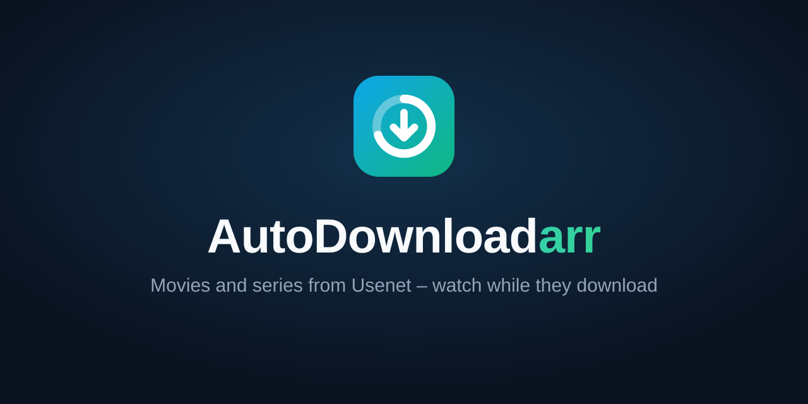

<p align="center"></p>

# AutoDownloadarr

**Watch once, then let it go.** AutoDownloadarr fetches movies and series from
Usenet for one-time viewing, adds them to your media server while they are
still unpacking, and removes them again after you have watched them.

It complements Sonarr and Radarr: they build the collection you keep,
AutoDownloadarr handles everything you only want to see once.

> **Status: early development.** Movies work end to end: search, request,
> download with extraction while downloading, PAR2 repair, 7z/ZIP, automatic
> fallback to the next release, Plex/Jellyfin/Emby integration and automatic
> deletion after watching. Series keep a rolling window of the next episodes:
> watched ones are removed and the next ones fetched. Administrators manage
> additional accounts, optionally with limits on requests and storage. The Plex
> watchlist can request movies and series automatically. See the
> [roadmap](docs/PLAN.md#14-roadmap).

## Planned features

- Built-in Usenet downloader that unpacks **while downloading**, with PAR2
  repair, password handling and automatic fallback to the next release
- Newznab indexers, quality profiles (maximum resolution, required and
  forbidden words, e.g. German releases only)
- Plex, Jellyfin and Emby: new items appear immediately, watched ones are
  removed after a configurable delay (default 48 h)
- Series as a rolling window: only the next *n* episodes are kept; starting the
  next episode removes the watched one and fetches another; future seasons can
  be subscribed. If no single episode release exists, a season pack is used as
  a fallback and only the needed episodes are kept
- Several users: administrators manage accounts, everyone requests movies and
  series, and optional per-user limits cap active requests and stored gigabytes
- Optional full availability check before downloading (every article, `STAT`
  with pipelining), so a download does not fail halfway
- Only new viewing counts: Plex remembers titles watched long ago, that history
  does not trigger deletions
- Download page with running downloads, queue and history
- Folder mapping between the container and the media server
- Multiple ways to request: web UI, API and the Plex watchlist (movies and
  series)

The full design is in [docs/PLAN.md](docs/PLAN.md).

## Quick start (Docker)

```yaml
services:
  autodownloadarr:
    image: ghcr.io/shyper/autodownloadarr:latest
    environment:
      - PUID=1000
      - PGID=1000
      - TZ=Europe/Berlin
    volumes:
      - ./config:/config
    ports:
      - "8686:8686"
    restart: unless-stopped
```

1. Start the container: `docker compose up -d`
2. Read the one-time setup token from the log: `docker logs autodownloadarr`
3. Open <http://localhost:8686> and follow the setup wizard: Usenet provider,
   indexer, movies folder and TMDB key, media server (Plex, Jellyfin or Emby).

Credentials (Usenet password, API keys, media server tokens) are stored encrypted with
a key in `/config/secret.key`. Keep that file with your backups.

## Configuration

Settings are made in the web UI. Environment variables only cover what is
needed before the database is available:

| Variable | Default | Description |
|---|---|---|
| `AUTODOWNLOADARR_LISTEN` | `:8686` | HTTP listen address |
| `AUTODOWNLOADARR_CONFIG_DIR` | `/config` | Database and other state |
| `AUTODOWNLOADARR_LOG_LEVEL` | `info` | `debug`, `info`, `warn`, `error` |
| `AUTODOWNLOADARR_LOG_FORMAT` | `text` | `text` or `json` |
| `AUTODOWNLOADARR_TRUST_PROXY` | `false` | Honour `X-Forwarded-For`/`-Proto`. Enable only behind a reverse proxy. |
| `AUTODOWNLOADARR_SESSION_TTL` | `720h` | How long a login stays valid without activity |
| `AUTODOWNLOADARR_PUBLIC_URL` | disabled | Public HTTPS origin, e.g. `https://media.example.com`. Required for OAuth/MCP and bot account linking. HTTP is allowed only on loopback for development. |
| `AUTODOWNLOADARR_TMDB_URL` | TMDB API | Alternative TMDB endpoint (proxies, tests) |
| `PUID` / `PGID` | `1000` | User and group the server runs as (Docker image) |

### Forgot your password?

```bash
docker exec -it -u 1000:1000 autodownloadarr /app/autodownloadarr reset-password admin
```

The new password is read from the terminal; all sessions of that user are
signed out.

### Trying the downloader

The built-in Usenet client can be run on its own. It downloads an NZB and
extracts RAR archives while they are still downloading:

```bash
export AUTODOWNLOADARR_NNTP_SERVER=news.example.com:563
export AUTODOWNLOADARR_NNTP_USER=myuser
read -rs AUTODOWNLOADARR_NNTP_PASSWORD && export AUTODOWNLOADARR_NNTP_PASSWORD
autodownloadarr download-nzb -connections 30 -out ./downloads release.nzb
```

Run `autodownloadarr download-nzb -h` for all options (archive password,
keeping archives, PAR2 recovery volumes, …).

## Development

Requirements: Go 1.26+, Node.js 24+, and for the repair and extraction
tests `par2` (par2cmdline) and 7-Zip (`7zz`, `7z` or `7za`).

```bash
make web        # build the web UI (embedded into the binary)
make run        # start the server on :8686 with ./config
make dev-web    # Vite dev server on :5173 with hot reload, proxies /api
make test       # Go and web tests
make lint       # go vet, golangci-lint, ESLint, TypeScript
make docker     # build the image
```

Project layout:

```
cmd/autodownloadarr/   entry point and CLI commands
internal/api/          HTTP API (/api/v1) and static file serving
internal/fetch/        download, extraction and repair shared by movies and series
internal/movies/       movie lifecycle: search, download, Plex, deletion
internal/series/       series: rolling window of episodes
internal/store/        persistence of settings, providers and movies
internal/release/      release name parser, quality profiles
internal/indexer/      Newznab client
internal/metadata/     TMDB client
internal/mediaserver/  Plex and Jellyfin/Emby clients, path mapping
internal/watchlist/    import of the Plex watchlist
internal/secrets/      encryption of stored credentials
internal/auth/         accounts, sessions, rate limiting, setup token
internal/config/       environment configuration
internal/db/           SQLite and migrations
internal/events/       in-process event bus (live updates)
internal/scheduler/    persistent, retryable background tasks
internal/usenet/       NZB parser, NNTP client and pool, yEnc, downloader,
                       extraction (unpack); nntp/nntptest is a fake server
internal/testutil/     test helpers (e.g. a writer for RAR5 test archives)
internal/webui/        embedded web UI build
web/                   React + TypeScript frontend
```

See [CONTRIBUTING.md](CONTRIBUTING.md) for conventions.

## License

[GPL-3.0](LICENSE)

### MCP and delegated access

Set `AUTODOWNLOADARR_PUBLIC_URL` to the externally reachable HTTPS origin, then
connect an MCP client to `<public-url>/mcp`. AutoDownloadarr exposes OAuth discovery
metadata and an authorization-code flow with S256 PKCE using existing user accounts.
Clients can use a public HTTPS Client ID Metadata Document; administrators can also
register fixed clients with exact redirect URLs under Account → Connected applications.
Only the authorization-code and refresh-token grants are supported. Request
`offline_access` when the client needs a rotating refresh token.

The consent page allows separate `media:read`, `media:request`, `media:manage` and
`media:delete` permissions. A grant never expands the user's account permissions:
everyone can read the shared library; users change only their own requests;
administrators can manage all requests. Movie restoration also checks ownership.
Unassigned legacy requests and new watchlist requests belong to the first account;
existing explicit owners are preserved. Grants can be revoked from Account and
are revoked on password changes or resets. Tokens are stored only as hashes.

MCP tools cover catalog searches/details, movie/series requests, library and episode
details, releases, downloads, queue/history, keep/pause/window settings, retries,
release selection and deletion. The endpoint uses the official Go MCP SDK and
stateless Streamable HTTP. It does not expose provider credentials or configuration.

### Interactive Telegram and Discord bots

Bots are configured independently of the existing notification destinations under
Settings → Bots. Their tokens are encrypted in the database. Save configuration,
then use **Test connection** and **Sync commands** (also after changing delivery
mode). Connection tests do not send chat messages.

- **Telegram:** create a bot with `@BotFather`, enter its token, and use long polling
  by default. No inbound Telegram endpoint is required in this mode. Optional
  webhook mode registers `<public-url>/bots/telegram/webhook` with a generated
  secret header when commands are synced. Only private chats are accepted.
- **Discord:** create an application in the Developer Portal, enable Guild Install
  and User Install, and enter its Application ID, Public Key and Bot Token. Set the
  Interactions Endpoint URL to `<public-url>/bots/discord/interactions`, then sync
  commands and install the app. No Gateway connection or privileged Message Content
  intent is needed. Server interactions require an explicit server-ID allowlist;
  direct messages and personal app contexts work without a server allowlist.

Run `/connect` in either bot, sign in on the linked AutoDownloadarr page and confirm
account linking. Links expire after ten minutes and cannot replace another user's
existing connection. Account → Connected bots controls language, personal
availability/failure notifications and disconnection. Password changes and resets
also disconnect bots.

Commands: `/search` (movies), `/series`, `/library`, `/downloads`, `/language`,
`/connect`, `/help`. Telegram also accepts a movie title as an ordinary message.
Discord offers title autocomplete, private responses and Components V2 menus.
Both bots offer posters, genres, seasons, rolling windows, keep/pause controls and
confirmed deletion. Shared library browsing is available; write operations always
use the linked account's ownership permissions and quotas.

Inbound updates and prepared replies are persisted; retries of a failed reply do
not repeat its media operation. Buttons are short-lived, bound to the invoking
platform user and single-use. Notifications are recovered by polling persistent
media state. API rate limits respect provider retry delays through the scheduler.
